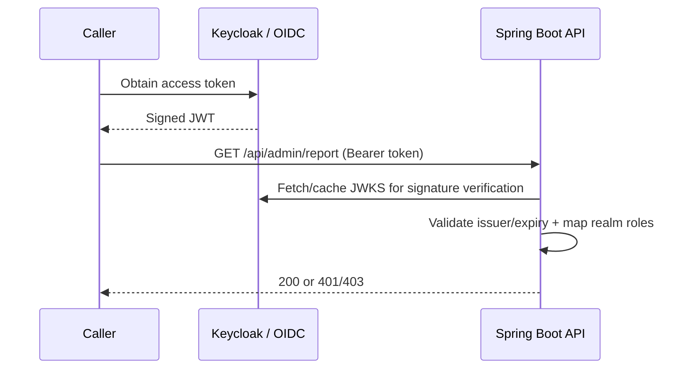

# Spring Security | OAuth2 Resource Server + OIDC/RBAC

**Java 21 · Spring Boot · Spring Security 6 · JWT · Keycloak · RBAC · Negative security tests**

A stateless REST API with **real issuer-signed JWT validation** and a deliberate separation between authentication (OIDC) and authorization (application roles).

## Architecture



## Features

- Validates JWT signature, expiry and issuer via Spring Security Resource Server.
- Maps `realm_access.roles` to `ROLE_*` while preserving `SCOPE_*` authorities.
- Deny-by-default route policy, stateless bearer authentication.
- Unit tests for claims mapping and MVC tests for **401 / 403 / 200**.
- Local Keycloak setup with demo realm, users, and roles.

## Local run

Requirements: Java 21, Maven 3.9+, Docker.

```bash
docker compose up -d
mvn spring-boot:run
```

Fetch a **local-only** demo token:

```bash
curl -s -X POST http://localhost:8081/realms/portfolio/protocol/openid-connect/token \
  -d 'client_id=portfolio-cli' -d 'grant_type=password' \
  -d 'username=admin-demo' -d 'password=admin-local-only'
```

Use the `access_token` field as your Bearer token:

```bash
curl -H "Authorization: Bearer $TOKEN" http://localhost:8080/api/admin/report
```

Endpoints: `/api/public/ping` (public), `/api/profile/me` (authenticated), `/api/admin/report` (ADMIN only).

## Security trade-offs

- **Never** use the embedded dev usernames/passwords, Keycloak `start-dev`, or password grant in production. The password grant exists solely to make local exploration quick; production clients should use Authorization Code + PKCE or suitable machine credentials.
- In production validate `aud` (audience), use HTTPS, enable structured access logs without logging tokens, and implement key rotation and rate limits. Spring's issuer validation alone does not enforce a custom audience.
- Role names are supplied by the IdP; don't trust arbitrary user-controlled claims. The resource server validates the token signature against the issuer's JWKS.
- Access control is intentionally server-side. Never rely on hiding frontend buttons.

## Verification

`mvn verify` runs isolated security tests; no Keycloak container is needed for these unit/MVC tests.

_Independent portfolio demonstration. Not affiliated with any employer or customer._
